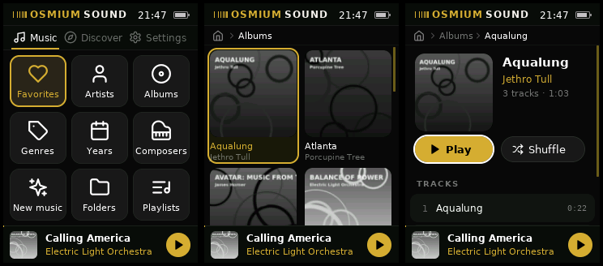
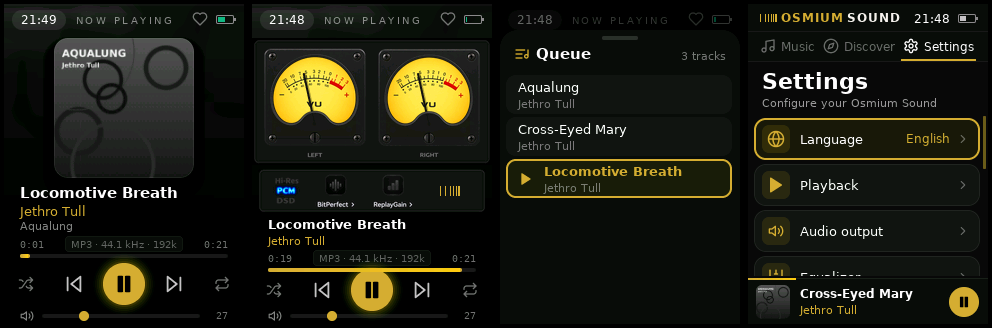

# Osmium Pod — Osmium Sound for the FiiO M3K

> **⚠️ DISCLAIMER: PERSONAL PROJECT**
> This project is a personal fork of Rockbox. It is provided **"AS IS"** without support or warranty of any kind. Future maintenance or updates are not guaranteed.

The Rockbox core — firmware, drivers, codecs and the playback engine — with
a new player interface, written from scratch to look and behave like
[Osmium Sound](https://github.com/adri6412/osmium-sound), adapted to the
FiiO M3K (240×320 screen, touch pad, scroll wheel and side keys).




## Supported Devices
This fork has been **tested EXCLUSIVELY on the FiiO M3K**.
The interface is built for the M3K screen and keys: other targets are not supported. **Use at your own risk.**

## What is in the tree

* **Rockbox core** (`firmware/`, `lib/`, `apps/playback.c`, `apps/buffering.c`,
  `apps/playlist.c`, `apps/tagcache.c`, …): kernel, drivers (LCD, audio codec,
  AXP PMU, USB, SD), codecs, DSP, database, playlists, album art. Unchanged
  except where the old interface was referenced.
* **Osmium Sound interface** (`apps/osmium/`): replaces the whole Rockbox GUI
  (lists, WPS, skins, themes, menus, quick screen, plugins).
  * `osm_gfx.c` — drawing on a private RGB565 frame buffer: rounded cards,
    gradients, glow, anti-aliased text (DejaVu Sans, pre-rendered), icons
    (Lucide), images and covers with bilinear scaling.
  * `osm_ui.c` — screens and transitions, keys (short / long press), toasts,
    menus, dialogs, mini player, status bar.
  * `osm_player.c` — the player model on top of the playback engine
    (track info, codec chip, LEDs, VU meters, favorites, sleep timer).
  * `osm_library.c` — library views from the database, album grouping,
    cover thumbnails decoded in a background thread.
  * `scr_home.c`, `scr_browse.c`, `scr_nowplaying.c`, `scr_settings.c` — the screens.
  * `osm_settings.c` — settings, stored as text in `/.rockbox/osmium.cfg`.
* **Asset generators** (`tools/osmium/`): fonts, icons and images are
  generated into `apps/osmium/assets/` (`gen_fonts.py`, `gen_icons.py`,
  `gen_images.py`), the English / Italian strings into
  `apps/osmium/osm_strings.[ch]` (`gen_strings.py`, from `strings.txt`).
  The generated files are committed, the build does not need Python.

How the pieces fit together (threads, the hooks between the core and the
interface, how to update the Rockbox core): see
[architecture.md](architecture.md).

## Features

* **Home** with the Osmium tabs: *Music* (Favorites, Artists, Albums, Genres,
  Years, Composers, New music, Folders, Playlists), *Discover* (shuffle all,
  random album, most / recently played, recently added, never played) and
  *Settings*.
* **Album grid** with covers, album pages with Play / Shuffle and track list,
  artist pages, jump letter while scrolling fast.
* **Now Playing** with blurred backdrop, cover or **analog VU meters** with the
  LED plate (Hi-Res, PCM/DSD, BitPerfect, ReplayGain), codec chip
  (`FLAC · 44.1 kHz · 905k`), gold progress bar and play disc, queue sheet.
* **Favorites** (`/.rockbox/favorites.m3u8`), play next / add to queue,
  sleep timer, resume at boot.
* **Settings**: playback (shuffle, repeat, crossfade, ReplayGain, cue sheets,
  fade on stop…), audio output (volume limit, DAC filter, bass / treble,
  balance, crossfeed…), equalizer, Now Playing (view, VU look), display and
  keys, library (update / rebuild the database), power and sleep, about.
  English and Italian.
* The database (tagcache) builds and updates itself in the background:
  copy music over USB and it shows up in the library.

## Controls

| Key | Short press | Long press |
|---|---|---|
| Power | Lock / unlock the keys | Power off |
| Play | Play / pause | Stop |
| Vol + / Vol − | Volume (anywhere) | |
| Up / Down / Left / Right | Move the focus | |
| Select | Open / play | Context menu (play next, queue, favorites, go to album / artist) |
| Back | Back (hides Now Playing) | Home |
| Menu | Show / hide Now Playing | Now Playing menu (on Now Playing) |
| Wheel | Scroll lists; on Now Playing: volume or seek (setting) | |

On **Now Playing**: Left / Right previous / next track (hold to seek),
Up opens the queue, Down switches between cover and VU meters.

## Compilation Guide (Linux or WSL)

### Prerequisites
1.  **Rockbox Toolchain**: **CRITICAL**: Do NOT rely on `apt-get install gcc-mipsel-linux-gnu`. You **must** build the official toolchain using the helper script inside `tools/`:
    ```bash
    cd tools
    sudo ./rockboxdev.sh --target=i --prefix=/opt/mips
    export PATH=/opt/mips/bin:$PATH
    ```

### How to Build
```bash
mkdir build && cd build
../tools/configure --target=fiiom3k --type=N
make -j$(nproc)
make zip            # rockbox.zip: unzip it to the root of the SD card
```
Optionally copy a fallback font for scripts the built-in fonts do not cover
(CJK…): `tools/convbdf -f -o .rockbox/fonts/16-GNU-Unifont.fnt fonts/16-GNU-Unifont.bdf`.

### Simulator
```bash
mkdir sim && cd sim
../tools/configure --target=fiiom3k --type=s
make -j$(nproc) && make install
./rockboxui
```
Keys: arrows, Enter (Select), Backspace (Back), Insert (Menu), Space (Play),
`+` / `-` (volume), Page Up / Page Down (wheel), Esc (Power).

## Releases

The GitHub workflow (`.github/workflows/rockbox.yml`) builds the firmware
on every push (package in the run's artifacts) and publishes
a **GitHub release** with `osmium-pod-fiiom3k-<version>.zip`:

* push a tag: `git tag v1.0.0 && git push origin v1.0.0`, or
* *Actions → Build Rockbox for FiiO M3K → Run workflow*, entering the version.

Each release also carries `bootloader.m3k` (see "Rockbox in flash"), and
`.github/workflows/pages.yml` then publishes the **web installer**
(`site/`) on GitHub Pages: <https://adri6412.github.io/osmium-pod/>. From
Chrome or Edge it installs everything in one click, with no tools and no
card needed: it puts the player's USB boot mode to use (WebUSB, the same
protocol as jztool) to load `installer.m3k` together with a package
holding the bootloader and the `.rockbox` folder. The installer, shown on
the player's screen, saves a backup of the FiiO firmware on the card if
one is in, writes the bootloader, the Rockbox image and the internal
storage, and restarts. Updates go the same way, keeping settings and
library. The page serves the release files from
its own origin, because GitHub release downloads cannot be fetched by a
web page. The workflow publishes to the `gh-pages` branch: for a first
deployment, set *Settings → Pages → Source* to *Deploy from a branch*,
`gh-pages`, `/ (root)`.

To install by hand, unzip the release archive to the root of the M3K's
microSD card (overwriting the files in `.rockbox`) and restart the player.

The firmware runs on the **official** Rockbox bootloader for the M3K
(<https://download.rockbox.org/>). That is the tested setup, and the one
releases are made for.

## Rockbox in flash (experimental)

The bootloader built from this tree (`--type=B`) can keep `rockbox.m3k`
in the M3K's internal NAND, **in place of the FiiO firmware**, which is
lost and can no longer be started. The card is still needed: codecs,
settings, the database and the music stay on it. Only the main binary
moves to flash, so the player boots even if `.rockbox/rockbox.m3k` is
missing or damaged.

NAND layout:

| Offset   | Size     | Content                                       |
|----------|----------|-----------------------------------------------|
| 0x0      | 128 KiB  | SPL + bootloader (unchanged)                  |
| 0x20000  | 4 MiB    | Rockbox (was the FiiO kernel)                 |
| 0x420000 | ~124 MiB | Internal storage (see below); was the FiiO recovery kernel and UBI |

At every boot the bootloader:
1. compares `.rockbox/rockbox.m3k` on the card with the copy in flash, and
   writes it to flash if it differs (splash "Updating Rockbox in flash");
2. boots from flash. If the image is damaged, it is rewritten from the card
   and the boot is retried; failing that, Rockbox is started from the card.

So updates work as before: copy the new `.rockbox` to the card and restart.
The recovery menu (hold Volume Up at power on) adds *Rockbox (SD)*, to boot
the card's copy without touching flash, *Rockbox in flash → Install from
SD* to force the write, and *Debug tools → Dump Rockbox flash*.

Installing (build with `tools/configure --target=fiiom3k --type=B`):
1. Copy `bootloader.m3k` and the `.rockbox` folder to the card.
2. **Try it from RAM first.** Put the player in USB boot mode (power off,
   hold Volume Down while plugging the USB cable) and run
   `jztool fiiom3k load bootloader.m3k` (see `utils/jztool/README.md`).
3. From its recovery menu, back up first: *Bootloader → Backup*
   (`fiiom3k-boot.bin`) and *Debug tools → Dump entire flash*
   (`flash.img`, the only way to get the FiiO firmware back). Copy both
   files to a computer.
4. Choose *Rockbox*: the bootloader still runs from RAM, writes Rockbox to
   flash and boots it. Check that it works, also without the card.
5. Only then use *Bootloader → Install or update* to write the bootloader.

If the player shows a black screen, go back to USB boot mode and load a
working bootloader with jztool; from its recovery menu restore
`fiiom3k-boot.bin` or install the official `bootloader.m3k`. The X1000's
USB boot is in mask ROM, so it is always available. Keep `flash.img`:
it is the only copy of the FiiO firmware. This tree has no tool to write
it back to the NAND.

## Internal storage (experimental)

The rest of the NAND, from 0x420000 to the end, becomes an **internal
drive** of about 89 MiB, so that the whole `.rockbox` folder (codecs,
settings, database, resume, favorites) can live in the player and the card
holds only music. Wear leveling, bad blocks and power loss are handled by
[Dhara](https://github.com/dlbeer/dhara), a NAND flash translation layer;
the drive is FAT16 and shows up on the computer next to the card.

Nothing changes until you ask for it: *Settings → Internal storage →
Move the system to the internal storage*. The player restarts, formats
the internal drive and copies `.rockbox` there, then renames the card's
copy to `.rockbox.bak`. *Move the system back to the card* does the
opposite and erases the internal drive. If a copy fails, the system stays
where it was.

The card is still the root of the file system: music paths, playlists,
favorites and the database do not change, and the firmware sends
`/.rockbox` to the internal drive. Without a card the player still starts,
with an empty library; insert the card and it restarts to use it.

Updates work as before: copy a new release to the card (or use the web
installer). At the next start the player copies it into the internal
drive, keeping settings and database, renames it to `.rockbox.bak`, and
updates the copy of `rockbox.m3k` in flash.

## Credits
* [Rockbox](https://www.rockbox.org/) (GPL v2 or later).
* Interface design from [Osmium Sound](https://github.com/adri6412/osmium-sound).
* [DejaVu fonts](https://dejavu-fonts.github.io/) (Bitstream Vera / DejaVu license).
* [Lucide](https://lucide.dev/) icons (ISC license).
* [Dhara](https://github.com/dlbeer/dhara) NAND flash translation layer, by
  Daniel Beer (ISC license), in `firmware/target/mips/ingenic/dhara/`.
